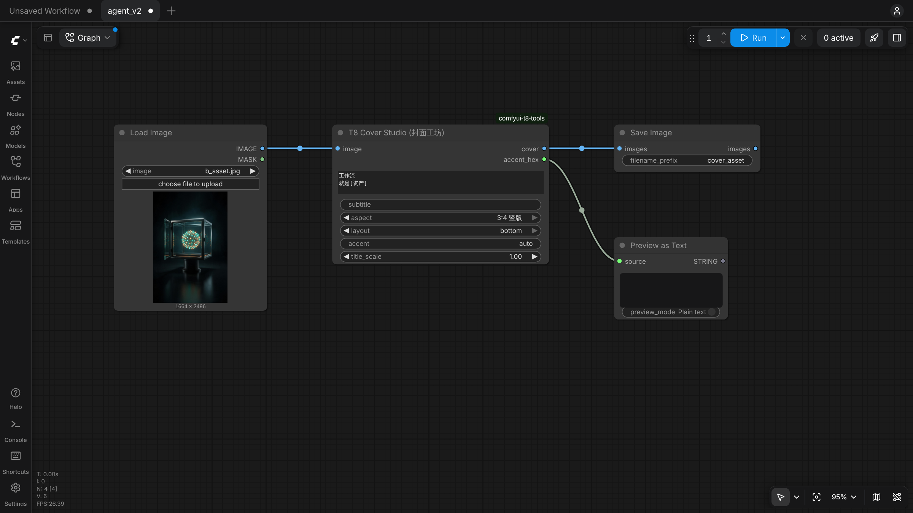

# comfyui-t8-tools

T8star 视频《ComfyUI 过时了吗？》中演示的自定义节点：用 Claude Code 一句话需求写出，放进 ComfyUI 即可使用。


## 节点

| 节点 | 作用 |
|---|---|
| **T8 Cover Studio（封面工坊）** | 生成图 + 标题 → 成品封面。智能裁切（按版式把主体留在标题之外）、可读性遮罩、从图里自动取主题色、大字标题（`[方括号]` 里的词高亮）、副标题胶囊；支持 16:10（B 站）、16:9（YouTube）、3:4 竖版；左 / 右 / 底三种版式 |
| T8 Text Watermark | 给图片加文字水印（支持中文），位置、字号、透明度可调 |
| T8 Color Palette | 提取图片主色 → 色卡图 + HEX 字符串 |



## 安装

```bash
cd ComfyUI/custom_nodes
git clone https://github.com/T8mars/comfyui-test comfyui-t8-tools
```

重启 ComfyUI，在节点搜索里输入 "T8" 或 "封面"。无额外依赖（只用 ComfyUI 自带的 torch、numpy、Pillow）。需要较新的 ComfyUI（使用 `comfy_api.latest` 节点接口，在 v0.43.0 上测试）。

## 封面工坊参数

- `title`：多行标题，换行即分行；`[过时]` 这样用方括号包住的词会加主题色底块
- `subtitle`：副标题（留空则不显示）
- `aspect`：`16:10 B站横版` / `16:9 YouTube` / `3:4 竖版`
- `layout`：`left` / `right` / `bottom`
- `accent`：`auto` 自动从图中取最鲜艳的颜色并提亮；也可填 `#FF6A1A`
- `title_scale`：标题整体缩放
- 输出 `cover`（图片）和 `accent_hex`（实际使用的主题色）

示例工作流：`examples/cover_workflow_api.json`（API 格式，可直接拖进 ComfyUI；示例底图 `examples/bg_asset.jpg` 先放进 `ComfyUI/input/`）。

## 字体与许可

- 标题字体：得意黑 Smiley Sans（SIL OFL 1.1），见 `fonts/README_LICENSES.txt`
- 副标题使用系统中文字体（Noto Sans CJK / 微软雅黑），找不到时退回标题字体
- 示例底图由博主用 AI 生成（Seedream），无第三方素材
